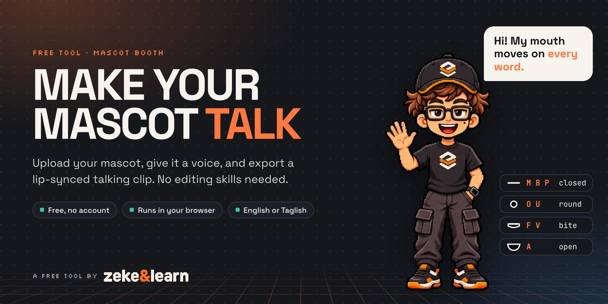
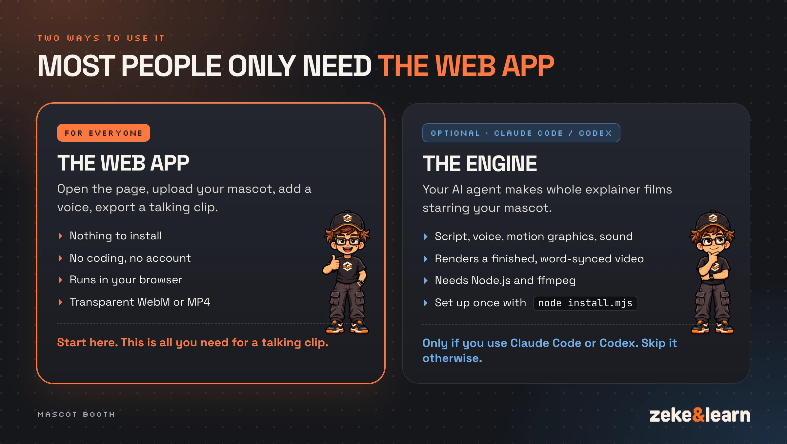
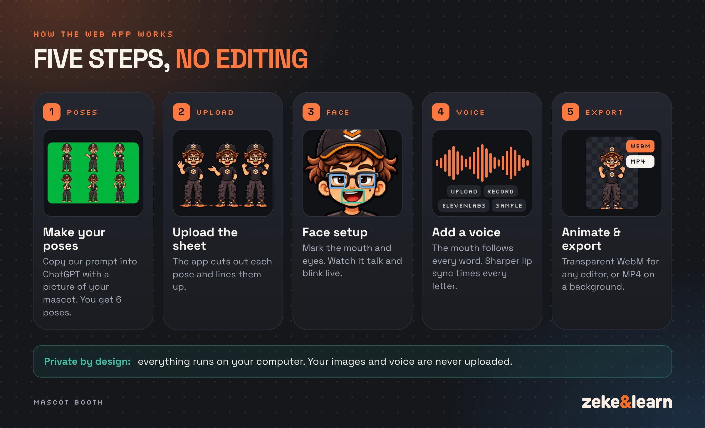
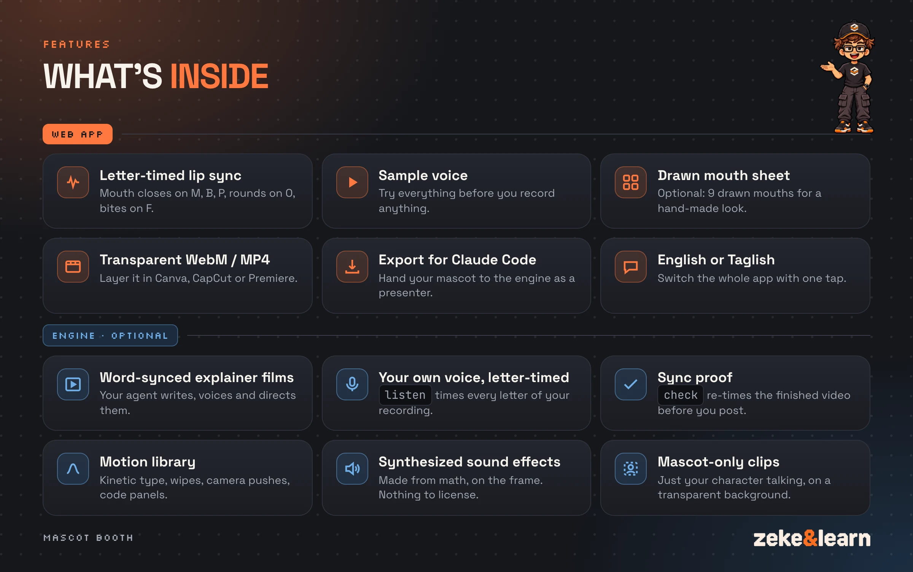

# Mascot Booth

<p align="center"></p>

<p align="center"><b><a href="https://zekeandlearn.github.io/mascot-booth/">Open Mascot Booth</a></b> · free, no account, runs in your browser</p>

Mascot Booth is a free tool by [Zeke & Learn](https://www.facebook.com/zekeandlearn). Give it a pose sheet of your
mascot and a voice, and it gives you back a lip-synced talking clip you can drop into any video. No account, no
uploads: everything runs in your browser.

## Do I need to install anything?

**No.** If you want a talking clip of your mascot, just
**[open the web app](https://zekeandlearn.github.io/mascot-booth/)** in Chrome or Edge on a computer. There is nothing
to download, no account and no coding.

<p align="center"></p>

This repo also has an **engine**, and that part is **optional**. It is only for people who already use an AI coding
agent, [Claude Code](https://claude.com/claude-code) or [Codex](https://openai.com/codex). Once installed, you can ask
your agent for a whole explainer video ("make a talking explainer about how DNS works") and it writes the script,
makes the voice, adds motion graphics and sound, and renders the finished film with your mascot as the presenter.

| | The web app | The engine (optional) |
|---|---|---|
| **Who it's for** | Everyone | Claude Code or Codex users |
| **What you get** | A talking mascot clip (transparent WebM or MP4) | Whole word-synced explainer films |
| **Install** | Nothing. [Open it in your browser](https://zekeandlearn.github.io/mascot-booth/) | Node.js, ffmpeg, then `node install.mjs` |
| **Skills needed** | None | Comfortable with a terminal |

If you don't use Claude Code or Codex, you can ignore everything about the engine below.

## How the web app works

<p align="center"></p>

## Features

<p align="center"></p>

**Web app**

- **Five simple steps:** make your poses, upload the sheet, set up the face, add a voice, animate and export.
- **Poses from ChatGPT.** Copy the ready-made prompt, attach a picture of your mascot, and you get a sheet of
  6 poses. The app cuts each pose out and lines them up on one baseline.
- **Face setup with a live preview.** The app guesses where the mouth and eyes are. Drag or draw a box to fix
  anything that's off, and watch the mascot talk and blink while you do.
- **Four ways to add a voice:** upload an audio file, record with your mic, use your own ElevenLabs key, or try the
  **sample voice** first.
- **Sharper lip sync for your own recording.** Times every letter you said, so the mouth closes on M, B and P, rounds
  on O and bites on F. It runs on your computer (see [Under the hood](#under-the-hood)).
- **Optional drawn mouth sheet.** A second prompt gets you 9 drawn mouths for different sounds, so the talking looks
  drawn instead of stretched. Skip it and your mascot talks with its own mouth.
- **Export a transparent WebM** to layer over anything in Canva, CapCut or Premiere, or an **MP4** on the background
  you pick (Green screen keys out in any editor).
- **Export for Claude Code.** Saves your mascot as a presenter folder (zip), so Claude Code or Codex can direct whole
  films with it.
- **English and Taglish** UI, switchable at the top.

**Engine (optional, for Claude Code / Codex)**

- **Letter-timed lip sync** from ElevenLabs (it returns a time for every letter) or from your own recording.
- **`listen`:** turns your own recording into a take with a time for every letter, using forced alignment (the method
  WhisperX uses) with a small speech model that runs on your computer. On an 85 s Taglish take, word starts landed
  27 ms from ElevenLabs' own timestamps at the median.
- **`prepare --audio`:** listen and prepare a take in one step.
- **Sync proof (`check`):** after every render, the engine listens to the finished video, times every word again and
  checks the voice still lands where the film was timed. It prints IN SYNC, or how far off and which words. On real
  renders it measured 1-2 ms; a test copy with the voice moved 50 ms late was caught.
- **Motion library:** springs, word-synced kinetic type, pixel-block wipes, camera pushes, presenter zooms, particle
  bursts, a live waveform, and terminal and code panels that type themselves. Every frame is a pure function of time,
  so previews, stills and the final render match exactly.
- **Synthesized sound effects:** whooshes, pops, key ticks, impacts, risers and 8-bit blips are generated from math at
  the frame their visual fires. No sample packs, nothing to license. The mix is mastered toward -14 LUFS with a -1 dBTP
  ceiling.
- **Mascot-only transparent clips:** just your character talking, directed by a small `direction.json`, rendered as a
  transparent WebM (or ProRes 4444 `.mov`).
- **Node only:** no Python. Works on Windows, macOS and Linux.

## Quick start

### Use the web app

Open **https://zekeandlearn.github.io/mascot-booth/** in Chrome or Edge on a computer. That's it. (Exporting video
needs Chrome or Edge.)

### Run the web app on your own computer (optional)

If you'd rather run your own copy, you need [Node.js](https://nodejs.org) 20 or newer. The web app has no
dependencies to install.

```bash
git clone https://github.com/zekeandlearn/mascot-booth.git
cd mascot-booth
node tools/serve-app.mjs
```

Then open http://localhost:4780.

### Install the engine (optional, for Claude Code / Codex)

Skip this unless you use Claude Code or Codex. You need Node.js 20+ and [ffmpeg](https://ffmpeg.org/download.html) on your `PATH`. `npm install` also downloads a
headless Chrome for rendering.

```bash
git clone https://github.com/zekeandlearn/mascot-booth.git
cd mascot-booth
node install.mjs
```

This installs dependencies, installs the `mascot-booth` skill for Claude Code (and for Codex, if you have it), and runs
`doctor` to check your setup. Restart your agent and say:

> use Mascot Booth to make a talking explainer about how DNS works

The first time, your agent turns your character art into a presenter. The quickest way is the web app: set up your
mascot there and click **Export for Claude Code**.

## Under the hood

### The web app

1. **Poses.** ChatGPT draws your mascot in 6 poses on a plain background. The app finds each figure, cuts it out and
   puts them all on one canvas with their feet on one line.
2. **Face.** You mark the mouth and eyes. To talk, the app squashes and stretches your mascot's own mouth into each
   shape (or swaps in your drawn mouths). To blink, it closes the eye inside each eye box.
3. **Voice to mouth shapes.**
   - With **ElevenLabs** or the **sample voice**, every letter already comes with a time.
   - With **Sharper lip sync**, a small speech model (wav2vec2) scores every letter every 20 ms and finds the best
     path through your words, which places each letter in time. If you paste your script it uses your words;
     otherwise a speech-to-text model (Whisper) writes down what you said first.
   - Without either, the mouth follows the loudness and brightness of the voice, which works in any language.
4. **Export.** The browser draws every frame and encodes the video on your computer.

### The engine (optional)

1. **Script.** The agent researches, writes in your voice and checks every claim. You approve the wording.
2. **Voice.** One whole-script take from your ElevenLabs voice, or your own recording of the script. You pick the take
   by ear.
3. **Cues.** The take becomes a cue sheet (`words.json`) and a mouth track (`mouth.json`).
4. **Storyboard.** One line per scene, each beat tied to a spoken word. You say go.
5. **Build.** The agent writes `film.js` against the cues and reviews contact sheets until it reads clean.
6. **Render.** Frame-exact video with synthesized sound design mixed under the voice, then the sync proof.

```bash
node bin/mascot-booth.mjs doctor
node bin/mascot-booth.mjs new films/dns --presenter ~/my-character
node bin/mascot-booth.mjs voice films/dns --script films/dns/script.md --voice <voice id> --name take-a
#   or your own recording instead of ElevenLabs (no API key; runs offline after a one-time model download):
#   node bin/mascot-booth.mjs listen films/dns --audio my-take.m4a --script films/dns/script.md --name take-a
node bin/mascot-booth.mjs prepare films/dns --take takes/take-a
node bin/mascot-booth.mjs cues films/dns
node bin/mascot-booth.mjs preview films/dns          # live player with a scrubber
node bin/mascot-booth.mjs stills films/dns --at 1,4,9 --sheet
node bin/mascot-booth.mjs render films/dns           # -> films/dns/renders/dns.mp4, then the sync proof
node bin/mascot-booth.mjs check films/dns            # run the sync proof again on its own
```

**Just the character, talking:** `new films/hi --mascot --presenter ~/my-character` makes a mascot-only film. Your
agent directs it in `direction.json` (pose, place, size, entrance and exit, each keyed to a spoken word),
`direction films/hi` checks it and prints the timeline, and `render films/hi` gives you `renders/hi.webm` with
transparency (`--alpha mov` for ProRes 4444).

**Your own character without the web app:** you need full-body pose sheets on a flat background (transparent, white
or chroma green), drawn at the same scale with gaps between figures. Then:

```bash
node bin/mascot-booth.mjs presenter cut --sheet sheet1.png --names idle,think,explain,cheer \
                                        --sheet sheet2.png --names wave,shrug,thumbs --out ~/my-character
```

The agent calibrates each pose's mouth and eye boxes against a gridded review sheet, then checks every mouth shape and
blink with `tests/presenter-review` before a film uses them. The full playbook is in
[`skills/mascot-booth/SKILL.md`](skills/mascot-booth/SKILL.md).

Run `node bin/mascot-booth.mjs` with no command to see every option.

## Your ElevenLabs key (optional, and safe)

**You never need an ElevenLabs key.** Upload an audio file or record with your mic instead, and you get the same
talking mascot (turn on **Sharper lip sync** for letter-exact mouths). If you'd rather not paste a key anywhere, just
don't use the ElevenLabs tab.

If you do use it, here is exactly what happens to your key:

- **It only ever goes to ElevenLabs.** Your browser sends it straight to `api.elevenlabs.io`, the same as the
  ElevenLabs website does. It never goes to us or anyone else. There is no Mascot Booth server, no account and no
  analytics: the app is a static page that runs in your browser.
- **It is never saved.** It lives in the password box while the tab is open. Refresh or close the tab and it's gone.
  The only thing the app remembers is your language choice.
- **In the engine** (Claude Code / Codex), the key is read only from the `ELEVENLABS_API_KEY` environment variable,
  sent only to ElevenLabs, and never printed or written to a file.
- **Extra safe:** make a separate key in your ElevenLabs account just for this, and delete it when you're done.
- **Don't take our word for it:** the code is open. Every network call the app makes is in `app/js/voice.js`
  (ElevenLabs, only when you click its buttons) and `app/js/listen-worker.js` (downloads the speech models for Sharper
  lip sync; it sends nothing).

## Privacy

- **Your images and voice stay on your computer.** Cutting out poses, lip sync and video export all happen in your
  browser. Nothing is uploaded.
- **Hosting:** the web app is a set of static files served by GitHub Pages. GitHub delivers the page like any
  website; after that, the app runs entirely in your browser.
- **No account and no analytics.** The only thing saved is your language choice, in your browser's local storage
  (`mascot-booth-lang`).
- **The network calls the web app makes:**
  - **ElevenLabs** (`api.elevenlabs.io`), only if you use the ElevenLabs tab: your key, your text, and the voice you
    pick.
  - **Sharper lip sync**, only if you click it: it downloads the Transformers.js library from jsDelivr
    (`cdn.jsdelivr.net`) and the speech models from Hugging Face (`huggingface.co`). These are downloads; your audio
    is not sent anywhere.
  - Links you click yourself (ChatGPT, the Zeke & Learn page, this repo).
- **The engine** downloads the same speech models from Hugging Face the first time you use `listen` (stored in
  `~/.mascot-booth/models`; set `MASCOT_BOOTH_MODELS` to use another folder), and calls ElevenLabs only for the
  `voice` command.

## FAQ

**Is it really free?**
Yes. The code is MIT licensed. ElevenLabs is optional and uses your own ElevenLabs account and credits.

**Do I need to know how to code or edit video?**
Not for the web app. You copy a prompt into ChatGPT, upload the image, fix a few boxes and export. The engine is for
people who use Claude Code or Codex.

**Which browsers work?**
Chrome or Edge on a computer. Other browsers may not be able to export video.

**Is there a website I can just open?**
Yes: https://zekeandlearn.github.io/mascot-booth/ (Chrome or Edge on a computer).

**Do I need to install the engine?**
No. The web app does everything you need for a talking mascot clip. The engine is an optional extra for people who
use Claude Code or Codex and want their agent to make whole explainer videos. If you don't use either, skip it.

**My pose sheet was rejected. What now?**
The app needs exactly 6 separate poses. Ask ChatGPT to "try again, keep the same character", with more space between
the poses.

**Why does the sample voice say "Cutscene"?**
That was this tool's working name. The sample was recorded before the rename to Mascot Booth.

**Can I use Cap Zeke or the Zeke & Learn logo?**
No. They're all rights reserved (see [License](#license)). Use your own mascot.

**Can I host my own copy?**
Yes, under the MIT license. The web app is a static site (`app/`), so any static host works. Replace the files listed
under [License](#license) with your own first.

## Credits

- Built by Zeke Espirito Sebulino ([Zeke & Learn](https://www.facebook.com/zekeandlearn)).
- Inspired by [talking-explainer](https://github.com/brewed-ops/talking-explainer) by Kenneth Villar. No code was
  copied from it.
- [Transformers.js](https://github.com/huggingface/transformers.js) by Hugging Face (Apache-2.0) runs the speech models
  in the browser and in Node.
- Speech models, downloaded at runtime and not included in this repo, each under its own license:
  - [`Xenova/wav2vec2-base-960h`](https://huggingface.co/Xenova/wav2vec2-base-960h): ONNX weights of
    [`facebook/wav2vec2-base-960h`](https://huggingface.co/facebook/wav2vec2-base-960h) (Apache-2.0).
  - [`onnx-community/whisper-base`](https://huggingface.co/onnx-community/whisper-base) (Apache-2.0), converted from
    [`openai/whisper-base`](https://huggingface.co/openai/whisper-base) (Apache-2.0).
- [mp4-muxer](https://github.com/Vanilagy/mp4-muxer) and [webm-muxer](https://github.com/Vanilagy/webm-muxer) by
  Vanilagy (MIT), bundled in `app/vendor/` with their licenses. The WebM muxer has a small patch to store the alpha
  channel.
- [Puppeteer](https://pptr.dev) and [sharp](https://sharp.pixelplumbing.com) (both Apache-2.0) for the engine.
- Fonts: Space Grotesk, JetBrains Mono, Silkscreen and Pixelify Sans, all SIL Open Font License 1.1.

## License

The code is [MIT](LICENSE). Copyright (c) 2026 Zeke Espirito Sebulino (Zeke & Learn).

Not covered by MIT, and **all rights reserved**:

- The Zeke & Learn logo and icons (`app/assets/brand/`)
- The Cap Zeke guide art (`app/assets/guide/`)
- The Cap Zeke images and graphics in `docs/`
- The sample voice (`app/assets/sample/`), an AI clone of Zeke's voice made with ElevenLabs

If you fork this and host your own copy, replace those with your own. Fonts are under the SIL Open Font License 1.1
(license files are in `app/assets/fonts/`). The speech models are not bundled. Full terms: [LICENSE](LICENSE) (code)
and [ASSETS.md](ASSETS.md) (brand assets and third-party notices).
